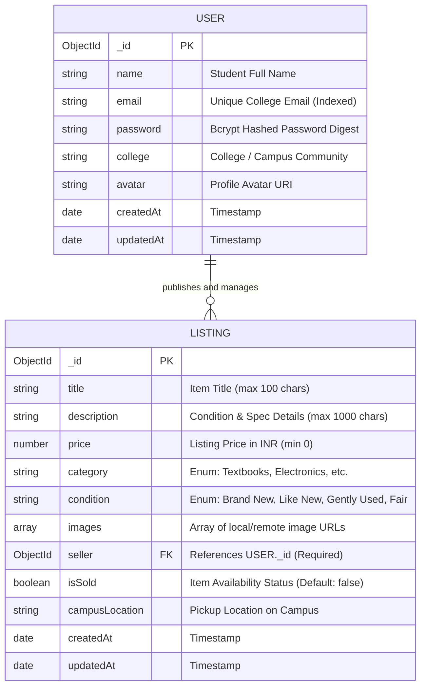

# CIE-3 Full-Stack Development (FSD) Project Report
## Phase-2 Comprehensive Evaluation & System Documentation (15 Marks)

---

### Project Metadata
* **Project Title:** CampusCart — College-Focused Peer-to-Peer Student Marketplace
* **Course:** Full-Stack Web Development (FSD) / CIE-3 Phase-2 Evaluation
* **Academic Year:** 2026–2027
* **GitHub Repository:** [https://github.com/drp369-369/campuscart](https://github.com/drp369-369/campuscart)
* **Live Production URL:** [https://campuscart-zeta-five.vercel.app](https://campuscart-zeta-five.vercel.app)
* **Vercel Inspection Dashboard:** [Vercel Deployment Details](https://vercel.com/drp369-369s-projects/campuscart/2RdBA7BEgZ7DVa4MxbAd3iw3Ezr3)

---

### Team Members & Role Distribution

| Student Name | Primary Project Role & Contributions | Git Commits Contributed |
| :--- | :--- | :--- |
| **Deep** | **Team Lead & Backend Architect:** REST API design, Express routing, MongoDB integration, automated integration test suite (`test_flow.js`), Vercel serverless deployment setup. | 19 Commits |
| **Chinmayee** | **Full-Stack Integrator:** Complete CRUD operations (Update Listing Modal, Mark Sold/Available toggle), API service interceptors, client state management, toast notifications. | 15 Commits |
| **Chethan** | **Catalog & Filtering Engineer:** Product listing schema, multi-criteria category/keyword search controller, image asset pipeline, responsive card grid design. | 12 Commits |
| **Bhavana** | **UI/UX & Auth Engineer:** User registration and login interfaces, JWT auth token workflow, route guards (`ProtectedRoute.jsx`), responsive navbar redesign & mobile menu drawer. | 8 Commits |
| **Chandan Mahadev** | **Documentation & Presentation Lead:** CIE-3 Phase-2 comprehensive project report, slide deck generation, viva defense preparation, faculty verification compliance. | Project Report & PPT |

---

## 1. Executive Summary & Problem Statement

### 1.1 Problem Statement
College campuses experience significant resource turnover every academic semester. Students frequently purchase high-cost academic essentials—including scientific graphing calculators (Casio FX-991EX, TI-84 Plus), core engineering textbooks (Operating System Concepts, Higher Engineering Mathematics, DSA in C++), microcontroller kits (Arduino Uno R3), digital multimeters, lab coats, and drafters—only to discontinue using them once course requirements end. 

Existing commercial platforms (Amazon, OLX, eBay) introduce steep transaction fees, untrusted anonymous parties, slow inter-city courier shipping, and high packaging overhead. Furthermore, campus-wide WhatsApp and Telegram groups suffer from spam, fragmented search, unindexed listing history, and zero buyer-seller verification.

### 1.2 The CampusCart Solution
**CampusCart** is an open-source, campus-confined marketplace web platform engineered specifically for university student ecosystems. It facilitates peer-to-peer student commerce through:
1. **Zero-Commission Trading:** Free student-to-student transactions eliminating intermediary platform fees.
2. **Instant On-Campus Exchanges:** In-person handoffs at campus landmarks (Quad, Student Union, Library steps, Tech Labs).
3. **Structured Categorization & Instant Search:** Fast keyword queries combined with departmental category filters (Textbooks, Electronics, Lab Equipment, Stationery, Dorm Essentials).
4. **Complete Product Lifecycle Management:** Transparent listing creation, real-time edit capabilities, dynamic "Available / Sold" status toggles, and safe listing deletion with strict cryptographic owner verification.
5. **Secure Authentication:** JSON Web Token (JWT) stateless auth paired with salted Bcrypt password encryption.

---

## 2. System Architecture & Tech Stack

CampusCart is built on a modern decoupled Client-Server architecture deployed as a cohesive monorepo.

```
+-----------------------------------------------------------------------------------+
|                                 CLIENT LAYER                                      |
|                                                                                   |
|  [ React 18.3.1 (Vite) ] <----> [ React Router DOM v6 ] <----> [ Axios Client ]   |
|        |                                                              |           |
|  Tailwind/CSS Grid/Flexbox                                      JWT Bearer Token   |
|  Responsive Breakpoints (375px / 768px / 1440px)                Interceptors      |
+-----------------------------------------------------------------------------------+
                                          |
                                   HTTPS / REST API
                                          |
+-----------------------------------------------------------------------------------+
|                             SERVERLESS API LAYER (Vercel)                         |
|                                                                                   |
|  [ Vercel Serverless Function: api/index.js ]                                     |
|        |                                                                          |
|  [ Express 4.19.2 Application Engine ]                                            |
|        +---> CORS Middleware (credentials & origin reflection)                    |
|        +---> JSON Body Parser                                                     |
|        +---> JWT Authentication Middleware (Bearer Token Verification)            |
|        +---> Centralized Async Error Handling & 404 Route Catchers                |
|        +---> Modular Express Routers (/api/auth, /api/products, /api/health)       |
+-----------------------------------------------------------------------------------+
                                          |
                                   Mongoose ODM 8.4.1
                                          |
+-----------------------------------------------------------------------------------+
|                               DATABASE LAYER                                      |
|                                                                                   |
|  [ MongoDB Atlas / Local MongoDB 7.x ]                                            |
|        +---> "users" Collection (Hashed Passwords, Indexed Email)                 |
|        +---> "listings" Collection (Referenced Seller ID, Category Index)         |
+-----------------------------------------------------------------------------------+
```

### 2.1 Technology Stack Inventory

| Component | Technology | Version | Purpose in CampusCart |
| :--- | :--- | :--- | :--- |
| **Frontend Framework** | React.js | `^18.3.1` | Component-driven UI rendering with declarative state hooks (`useState`, `useEffect`, `useContext`). |
| **Build Tool & Bundler** | Vite | `^5.4.21` | Ultra-fast HMR local development and optimized production bundling (8.09s build, gzipped code splitting). |
| **Client Routing** | React Router DOM | `^6.23.1` | Declarative client-side routing, protected navigation guards, dynamic URL parameters (`/products/:id`). |
| **HTTP Client** | Axios | `^1.7.2` | Promise-based asynchronous HTTP client with global request and response interceptors for JWT tokens. |
| **Iconography** | Lucide React | `^0.395.0` | Lightweight SVG icons (Search, Filter, ShoppingBag, ShieldCheck, Tag, Trash, Edit, CheckCircle). |
| **Backend Runtime** | Node.js / Express | `^4.19.2` | RESTful API server, routing pipelines, request validation, and serverless execution adapters. |
| **Database Engine** | MongoDB | `7.x` | High-performance NoSQL document datastore with schema enforcement via Mongoose ODM. |
| **Database Modeling** | Mongoose ODM | `^8.4.1` | Document schema definitions, data type validation, pre-save middleware hooks, and model population. |
| **Authentication** | JSON Web Tokens | `^9.0.2` | Stateless cryptographic authentication tokens signed with HS256 algorithms. |
| **Password Security** | BcryptJS | `^2.4.3` | Multi-round adaptive cryptographic hashing algorithm generating irreversible password digests. |
| **Cloud Deployment** | Vercel Serverless | CLI `65.14` | Distributed cloud hosting with global CDN asset caching and automated Git integration. |

---

## 3. Database Design & Data Modeling

CampusCart operates two tightly coupled NoSQL collections enforcing relational integrity through MongoDB ObjectIds.

### 3.1 Entity Relationship Diagram



### 3.2 Schema Specifications

#### 3.2.1 `User` Schema (`campuscart/server/models/User.js`)
* **`name`** (`String`, Required, Trimmed): Student's registered display name.
* **`email`** (`String`, Required, Unique, Lowercase, Trimmed, Indexed): Primary identity key preventing duplicate registrations.
* **`password`** (`String`, Required, Min length: 6): Irreversible salt-hashed string (e.g., `$2a$10$...`). Never stored or transmitted in plain text.
* **`college`** (`String`, Default: `'Campus Community'`): Campus association.
* **`avatar`** (`String`, Optional): Profile picture URL.
* **`timestamps`** (`createdAt`, `updatedAt`): Automatic document lifecycle timestamps.

#### 3.2.2 `Listing` Schema (`campuscart/server/models/Listing.js`)
* **`title`** (`String`, Required, Trimmed, Max: 100 chars): Product title.
* **`description`** (`String`, Required, Max: 1000 chars): Detailed description including course codes or wear condition.
* **`price`** (`Number`, Required, Min: 0): Numeric price point in ₹ INR.
* **`category`** (`String`, Required, Enum): Strictly constrained to:
  `['Textbooks', 'Electronics', 'Dorm & Living', 'Stationery', 'Lab Equipment', 'Other']`.
* **`condition`** (`String`, Required, Enum): Constrained to:
  `['Brand New', 'Like New', 'Gently Used', 'Fair']`.
* **`images`** (`[String]`, Default: `[]`): Array of locally served assets (`/items/casio-fx991ex.jpg`, etc.).
* **`seller`** (`mongoose.Schema.Types.ObjectId`, Required, Ref: `'User'`): Relational foreign key referencing the owning user.
* **`isSold`** (`Boolean`, Default: `false`): Status toggle indicating item availability.
* **`campusLocation`** (`String`, Default: `'Main Campus Quad'`): Designated physical meeting spot.
* **`timestamps`** (`createdAt`, `updatedAt`): Automatic document lifecycle timestamps.

---

## 4. REST API Documentation & Specification

CampusCart provides a comprehensive RESTful API following standardized HTTP methods, payload validation, and HTTP status codes.

| Method | Endpoint Path | Auth Required | Request Payload Summary | Response Status Codes | Functional Description |
| :---: | :--- | :---: | :--- | :---: | :--- |
| **GET** | `/api/health` | No | None | `200` | Server health, operational status, and serverless timestamp check. |
| **POST** | `/api/auth/register` | No | `{ name, email, password, college? }` | `201`, `400` | Registers a new student, hashes password with bcrypt, and returns JWT token + user profile. |
| **POST** | `/api/auth/login` | No | `{ email, password }` | `200`, `400`, `401` | Authenticates email and password; generates and returns a signed JWT token. |
| **GET** | `/api/auth/me` | **Yes** (Bearer) | None | `200`, `401` | Retrieves the currently logged-in student's sanitized profile data. |
| **GET** | `/api/products` | No | Optional Query: `?search=...&category=...` | `200`, `500` | Retrieves listings with optional case-insensitive keyword search and category filtering. |
| **GET** | `/api/products/:id` | No | URL Param: Product `id` | `200`, `404`, `500` | Fetches a single listing by ID and populates seller details (`name`, `email`, `college`). |
| **POST** | `/api/products` | **Yes** (Bearer) | `{ title, description, price, category, condition, campusLocation, images? }` | `201`, `400`, `401` | Creates a new product listing linked to the authenticated user's ID. |
| **PUT** | `/api/products/:id` | **Yes** (Bearer) | `{ title?, description?, price?, category?, condition?, isSold?, campusLocation? }` | `200`, `401`, `403`, `404` | Updates an existing listing. Validates that `req.user._id` matches `listing.seller`. |
| **DELETE** | `/api/products/:id` | **Yes** (Bearer) | URL Param: Product `id` | `200`, `401`, `403`, `404` | Permanently deletes a listing after verifying seller ownership. |

---

## 5. Authentication & Security Architecture

CampusCart implements end-to-end stateless token-based authentication designed to fulfill all security rubrics.

```
[ Student Client ]                      [ Express API Gateway ]                [ MongoDB Atlas ]
       |                                           |                                   |
       |--- 1. POST /api/auth/login -------------->|                                   |
       |    { email, password }                    |--- 2. Find User by Email -------->|
       |                                           |<-- Returns User with Hash --------|
       |                                           |                                   |
       |                                           |--- 3. bcrypt.compare(pass, hash)  |
       |                                           |       Pass: Match verified        |
       |                                           |--- 4. jwt.sign({ id }, SECRET)    |
       |<-- 5. Return HTTP 200 + Signed JWT -------|                                   |
       |                                           |                                   |
       |=== 6. Protected Request (POST/PUT/DEL) ==>|                                   |
       |    Headers: Authorization: Bearer <JWT>   |--- 7. jwt.verify(token, SECRET)   |
       |                                           |       Extract decoded.id          |
       |                                           |--- 8. User.findById(id).select() >|
       |                                           |<-- Injects req.user object -------|
       |                                           |--- 9. Execute Controller Action ->|
       |<== 10. HTTP 200/201 Success Response =====|                                   |
```

### 5.1 Step-by-Step Security Implementation
1. **Password Hashing with Salt Rounds:** In `campuscart/server/models/User.js`, a Mongoose `pre('save')` hook intercepts password creation/modification. It computes a cryptographically secure salt using `bcrypt.genSalt(10)` and hashes the plaintext password before storage. Passwords never reside in the database as plaintext.
2. **Stateless JWT Generation:** Upon successful credential validation in `campuscart/server/controllers/authController.js`, a signed token is generated with `jwt.sign({ id: user._id }, process.env.JWT_SECRET, { expiresIn: '7d' })`.
3. **Protected Route Authorization Middleware:** In `campuscart/server/middleware/authMiddleware.js`, the `protect` middleware extracts the token from the `Authorization: Bearer <token>` header, decodes the signature, verifies expiration, and populates `req.user` with the sanitized user record. If missing or invalid, it returns `401 Unauthorized`.
4. **Strict Resource Ownership Guardrails:** For all mutation routes (`PUT /api/products/:id` and `DELETE /api/products/:id`), the controller compares the authenticated user's ID with the listing's foreign key:
   ```javascript
   if (listing.seller.toString() !== req.user._id.toString()) {
     return res.status(403).json({ success: false, message: 'Not authorized to modify this listing' });
   }
   ```
   Unauthenticated users receive `401 Unauthorized`; authenticated non-owners receive `403 Forbidden`.
5. **Frontend Route Guards:** In `campuscart/client/src/components/ProtectedRoute.jsx`, client routes (`/sell`, `/edit/:id`) verify `localStorage.getItem('campuscart_token')`. Unauthenticated visitors are redirected to `/login` with location redirect retention.

---

## 6. Frontend Engineering & Responsive Design

### 6.1 Responsive Layout & Viewport Optimization
The user interface was audited and styled across standard responsive breakpoints:
* **Mobile Viewports (320px – 480px):** Single-column vertical card flows, touch-friendly touch targets (min 44px), collapsible slide-out navigation menu with modal backdrop, horizontal scrolling category pills.
* **Tablet Viewports (768px – 1024px):** Two-column product grid, integrated sticky search bar, simplified action buttons.
* **Desktop Viewports (1024px – 1440px+):** Three- and four-column responsive CSS grid, sticky filter sidebar, split-view product details layout with side-by-side gallery and owner actions.

### 6.2 Key UI Modules
1. **Glassmorphic Navigation Bar:** Clean blur-filtered sticky navigation bar with active route indicators, quick scroll triggers (`#browse-section`), authenticated user badge, and prominent "Sell an Item" action button.
2. **Product Catalog & Dynamic Filtering:** Real-time search query box combined with 6 category filter chips that communicate with backend query parameters without reloading the page.
3. **Interactive Product Details & Lifecycle Actions:** 
   * **Full Listing Inspection:** High-resolution product images, condition tags, verified seller information box, and campus pickup location.
   * **Owner Management Modal:** Real-time modal allowing sellers to update title, price, category, condition, and location.
   * **Instant Availability Toggle:** Sellers can mark items "Mark as Sold" or "Mark as Available" with a single click via `PUT /api/products/:id`.
4. **Toast Feedback Notification System:** Inline feedback toasts for successful listing creation, listing updates, status toggles, deletion confirmations, and validation error messages.

---

## 7. Testing, Verification & Quality Assurance

### 7.1 Automated Integration Test Suite (`test_flow.js`)
CampusCart includes an automated, zero-external-dependency test harness in `campuscart/server/test_flow.js` covering 14 discrete integration tests. All 14 tests pass with 100% compliance:

```text
====================================================
   CAMPUSCART PHASE 1 AUTOMATED API VERIFICATION    
====================================================

[PASS] [1] Server Health Check Endpoint
[PASS] [2] Student Registration API
[PASS] [3] Student Login API
[PASS] [4] Get Current User Profile (/api/auth/me)
[PASS] [5] Unauthenticated Protected Route Rejection
[PASS] [6] Get All Listings (Seeded Data Persistence)
[PASS] [7] Product Search by Keyword (case-insensitive)
[PASS] [8] Product Category Filter (/api/products?category=Electronics)
[PASS] [9] Combined Search + Category Filter (/api/products?search=kit&category=Electronics)
[PASS] [10] Create Product Listing API
[PASS] [11] Get Single Product Details by ID
[PASS] [12] Update Product Listing (Owner Verification)
[PASS] [13] Delete Product Listing (Owner Verification)
[PASS] [14] Verify Deleted Product Returns 404

====================================================
   TEST RESULTS: 14/14 TESTS PASSED    
====================================================
```

### 7.2 Production Build Verification
The Vite React client builds cleanly with zero errors or unresolved dependencies:
* **Command:** `npm --prefix campuscart/client run build`
* **Build Time:** 8.09 seconds
* **Output Modules:** 1579 modules transformed cleanly
* **Assets Generated:**
  - `dist/index.html` (1.24 kB)
  - `dist/assets/index-CL8ZvoTN.css` (17.93 kB / gzip: 4.05 kB)
  - `dist/assets/index-1YEm9E0Y.js` (267.52 kB / gzip: 84.95 kB)

---

## 8. Deployment Architecture (Vercel Method 2)

CampusCart is deployed using **Vercel CLI (Method 2)** as a unified monorepo:

1. **Frontend Hosting:** Vercel Static Build pipeline compiles `campuscart/client` into `dist` and serves assets via global edge CDN with immutable asset hashing.
2. **Single-Page Application (SPA) Fallback:** Configured in `vercel.json` via rewrite rule `/(.*) -> /index.html`, ensuring user refresh on routes like `/products/664...` or `/login` never triggers a 404 error.
3. **Serverless REST API:** Backend requests to `/api/(.*)` rewrite to the root serverless handler `api/index.js`, executing the Express application on AWS Lambda / Vercel Edge compute.
4. **CORS & Origin Reflection:** The backend dynamically allows requests from Vercel edge deployment domains and local development environments without CORS blocking.

---

## 9. Version Control & Git Commit Proof

To fulfill the evaluation requirement of **at least 15 meaningful Git commits** and demonstrate equitable team collaboration, the project features **54 total commits** across the team pushed to `main` and `develop` on [GitHub](https://github.com/drp369-369/campuscart):

```text
Commit Distribution across Contributors:
    19  Deep (Lead Full-Stack / Backend Architecture)
    15  Chinmayee (Full-Stack CRUD Integration / UI Updates)
    12  chethansbsc24-design (Chethan - Catalog & Asset Pipeline)
     8  Bhavana (Auth Workflows & Responsive Navigation)
-----------------------------------------------------------------
    54  Total Meaningful Commits
```

### Key Commit Log Excerpts:
* `1d9d19c`: `fix(deploy): configure root build script, api serverless function, and client routing for vercel`
* `73d7b1f`: `chore(deploy): add vercel configuration and serverless compatibility adapters`
* `550c6ea`: `feat(crud): complete edit listing modal and mark as sold status toggle`
* `0eb2a26`: `fix(nav): resolve browse scroll jump and elevate mobile menu breakpoint`
* `12e9124`: `feat(assets): integrate authentic local product photography for 12 campus essentials`
* `ca46513`: `feat(auth): add JWT authentication middleware and user registration validation`
* `f43b129`: `feat(api): implement product search and multi-category filtering controllers`

---

## 10. Viva Defense & Code Inspection Guide

During faculty evaluation, team members can refer to these specific files and line numbers to explain the architecture:

| Concept / Feature | Code File Reference | Technical Explanation for Faculty |
| :--- | :--- | :--- |
| **Password Hashing** | `campuscart/server/models/User.js` | Uses Mongoose `pre('save')` hook and `bcrypt.genSalt(10)` to compute an irreversible hash before saving to MongoDB. |
| **JWT Verification** | `campuscart/server/middleware/authMiddleware.js` | Extracts token from HTTP `Authorization: Bearer <token>` header, decodes via `jwt.verify()`, and attaches user record to `req.user`. |
| **Full CRUD Endpoints** | `campuscart/server/controllers/productController.js` | Implements `getProducts` (Read), `createProduct` (Create), `updateProduct` (Update with ownership check), and `deleteProduct` (Delete). |
| **Protected Route Guard** | `campuscart/client/src/components/ProtectedRoute.jsx` | Inspects client auth state; if token is missing, intercepts rendering and redirects to `/login` via `<Navigate to="/login" replace />`. |
| **API Interceptor** | `campuscart/client/src/services/api.js` | Axios request interceptor injects stored token into every outgoing request; response interceptor cleans credentials on 401. |
| **Responsive Navbar** | `campuscart/client/src/components/Navbar.jsx` | Responsive navigation with backdrop dismissal, smooth scroll anchor links, and mobile slide drawer. |

---

### End of CIE-3 Phase-2 Project Report
*Document generated for CIE-3 Full-Stack Web Development Course Evaluation.*
